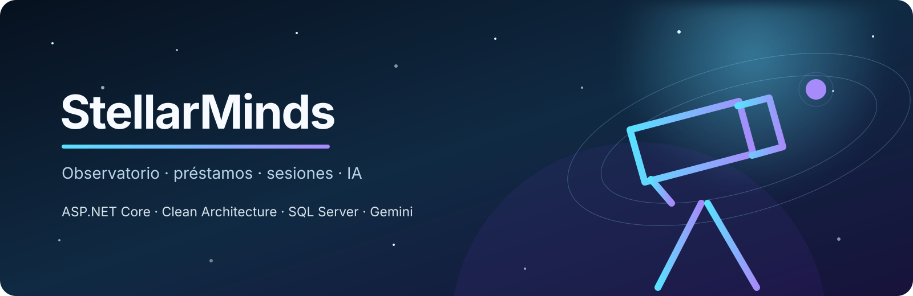
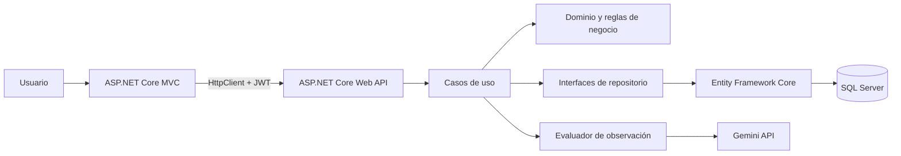

<p align="center">
  
</p>

<p align="center">
  <a href="https://github.com/FakuDLL/StellarMinds/actions/workflows/ci.yml"></a>
  
  
  
  
  
</p>

<p align="center">
  Plataforma web para administrar socios, equipos astronómicos, préstamos y sesiones de observación, con evaluación técnica asistida por IA.
</p>

## Project overview

**StellarMinds** is an academic web application for running an astronomy club. It manages members, equipment loans and observation sessions, and uses the Gemini API to evaluate whether a proposed equipment setup is suitable for an observation.

The solution combines a REST API and an ASP.NET Core MVC frontend with Entity Framework Core and SQL Server. The repository includes a relational schema, fictional sample data, versioned migrations, and diagrams of the main workflows.

See [local setup](#puesta-en-marcha) to run the project and [the architecture](#arquitectura) for how the application is organized.

### Project attribution and code tour

StellarMinds was built as an academic team project. Facundo Robayna ([@FakuDLL](https://github.com/FakuDLL)) prepared the [public portfolio edition](https://github.com/FakuDLL/StellarMinds/commit/a387497) and its [English project overview](https://github.com/FakuDLL/StellarMinds/pull/8). These links point to representative parts of the team's implementation.

- [REST API setup](SistemaStellarMinds/StellarMinds.WebApi/Program.cs) shows dependency registration and authentication configuration.
- [Equipment loan use case](SistemaStellarMinds/StellarMinds.LogicaAplicacion/CasosUso/CUAltaPrestamo.cs) shows how a loan is created and recorded.
- [Entity Framework Core context](SistemaStellarMinds/StellarMinds.AccesoDatos/ApplicationDbContext.cs) shows the data model and persistence configuration.
- [Build workflow](.github/workflows/ci.yml) checks that the API and MVC application compile.

## El proyecto

**StellarMinds** modela la operación de un observatorio y club de astronomía. La solución separa una API REST del cliente MVC y organiza el backend mediante capas, casos de uso, repositorios y un dominio con reglas propias.

El sistema resuelve tres desafíos principales:

- coordinar el préstamo y la devolución de telescopios, monturas, cámaras y oculares;
- aplicar reglas de compatibilidad y disponibilidad sin trasladar lógica crítica a la interfaz;
- evaluar con Gemini si una combinación de equipo es adecuada para observar o fotografiar un objeto celeste.

Fue desarrollado como proyecto académico de Diseño Web asistido por IA y se presenta aquí como pieza de portfolio. Los datos incluidos son completamente ficticios.

## Funcionalidades

| Área | Implementación |
|---|---|
| Autenticación | Login, logout, JWT y autorización por roles: administrador, coordinador y socio. |
| Socios | Alta con validación de datos, email único y contraseña robusta almacenada con BCrypt. |
| Equipos | CRUD polimórfico para telescopios, monturas, cámaras y oculares. |
| Préstamos | Alta, control de stock, compatibilidad montura/telescopio y elección obligatoria de cámara u ocular. |
| Disponibilidad | Consulta asíncrona desde JavaScript a un endpoint de la API antes de enviar el formulario. |
| Devoluciones | Cambio de estado, reposición de unidades y registro automático de auditoría. |
| Observaciones | Selección de un préstamo vigente, objeto celeste y fecha de observación. |
| Evaluación con IA | Envío de especificaciones técnicas a Gemini y respuesta estructurada: `IDEAL`, `ADECUADO` o `NO_RECOMENDABLE`. |
| Consultas | Préstamos mensuales, atrasos, socios por telescopio, ranking de objetos y detalle de auditorías. |

<details>
<summary><strong>Correspondencia con los requerimientos funcionales RF01-RF11</strong></summary>

| RF | Resultado |
|---|---|
| RF01 | Login y logout con permisos por rol. |
| RF02 | Alta de socios por un administrador. |
| RF03 | Gestión completa de equipos por un administrador. |
| RF04 | Alta de préstamos y disponibilidad consultada desde el cliente. |
| RF05 | Devolución de préstamos por un coordinador. |
| RF06 | Auditoría automática de altas y devoluciones. |
| RF07 | Alta de observaciones y evaluación con Gemini. |
| RF08 | Préstamos del socio por mes y año, incluyendo atrasos. |
| RF09 | Socios únicos por telescopio, ordenados de forma descendente. |
| RF10 | Ranking de objetos celestes observados. |
| RF11 | Consulta administrativa de auditorías y préstamos asociados. |

</details>

## Arquitectura



La dirección de dependencias mantiene el dominio independiente de infraestructura:

- **Lógica de negocio:** entidades, value objects, enumeraciones, excepciones y contratos de repositorio.
- **Lógica de aplicación:** casos de uso, validación de flujos y coordinación del dominio.
- **DTOs:** contratos de entrada/salida y mapeos entre capas.
- **Acceso a datos:** `DbContext`, configuraciones Fluent API, migraciones y repositorios EF Core.
- **Web API:** endpoints REST, JWT, políticas por rol, Swagger e integración server-side con Gemini.
- **Web MVC:** vistas Razor, ViewModels, sesión protegida y consumo exclusivo de la API mediante `HttpClient`.

<details>
<summary><strong>Ver diagramas UML</strong></summary>

### Casos de uso


### Modelo y capas


### Flujo de alta de observación


</details>

## Decisiones técnicas

### Dominio y persistencia

Las reglas relevantes viven en entidades y casos de uso, no en los controladores. Entity Framework Core persiste el modelo en SQL Server mediante configuraciones por entidad y migraciones versionadas. Las consultas se expresan con LINQ y los repositorios encapsulan el acceso a datos.

### Autenticación

La API emite tokens JWT con identidad y rol. Los endpoints sensibles usan políticas de autorización y el cliente MVC conserva el token en una sesión server-side con cookie `HttpOnly`. Las contraseñas nuevas se procesan con BCrypt; cualquier hash SHA-256 heredado se migra automáticamente a BCrypt después de un login válido.

### Integración con Gemini

El evaluador construye un JSON diferente para astrofotografía y observación visual. La llamada se realiza exclusivamente desde el backend, la API key se envía en la cabecera `x-goog-api-key` y la respuesta se valida antes de convertirla al modelo de dominio.

## Seguridad

Antes de publicar el repositorio se revisaron el árbol actual y todo su historial. La versión pública:

- no contiene credenciales de base de datos, API keys ni claves JWT reales;
- exige una clave JWT externa de al menos 32 bytes;
- mantiene secretos en User Secrets, variables de entorno o un gestor dedicado;
- limita los intentos de login y no expone Swagger en producción;
- restringe el detalle de préstamos a administradores y coordinadores;
- protege las operaciones MVC con antiforgery tokens y evita insertar respuestas de IA como HTML;
- usa cookies de sesión `HttpOnly`, `SameSite=Lax` y `Secure` en producción;
- incluye CI y actualizaciones automáticas de dependencias con Dependabot.

Consultá [SECURITY.md](./SECURITY.md) antes de reportar una vulnerabilidad.

## Puesta en marcha

### Requisitos

- [.NET 10 SDK](https://dotnet.microsoft.com/download/dotnet/10.0)
- SQL Server o SQL Server LocalDB
- una API key de Gemini para RF07

### 1. Clonar

```bash
git clone https://github.com/FakuDLL/StellarMinds.git
cd StellarMinds
```

### 2. Configurar los secretos de la API

```bash
cd SistemaStellarMinds/StellarMinds.WebApi
dotnet user-secrets set "Jwt:Key" "<clave-aleatoria-de-al-menos-32-bytes>"
dotnet user-secrets set "Gemini:ApiKey" "<tu-api-key-de-gemini>"
```

La configuración incluida apunta a `StellarMindsDb` en LocalDB. Para otra instancia, guardá también la conexión fuera del repositorio:

```bash
dotnet user-secrets set "ConnectionStrings:StellarMindsDb" "<tu-cadena-de-conexion>"
```

### 3. Crear la base

Desde `SistemaStellarMinds/StellarMinds.WebApi`:

```bash
dotnet tool restore
dotnet ef database update --project ../StellarMinds.AccesoDatos --startup-project .
```

Después ejecutá [BaseDeDatos/precarga_inserts.sql](./BaseDeDatos/precarga_inserts.sql) sobre una base vacía con las migraciones aplicadas.

También se incluye [BaseDeDatos/00-esquema.sql](./BaseDeDatos/00-esquema.sql) para inspección o creación manual del esquema, y [BaseDeDatos/precarga_limpieza.sql](./BaseDeDatos/precarga_limpieza.sql) para reiniciar únicamente los datos de prueba.

### 4. Ejecutar la API

```bash
dotnet run --launch-profile https
```

En desarrollo, Swagger queda disponible en `https://localhost:7267/swagger`.

### 5. Ejecutar el cliente MVC

En otra terminal, desde la raíz:

```bash
cd StellarMinds.WebApp
dotnet run --launch-profile https
```

Abrí `https://localhost:7287`. El cliente ya apunta a la URL HTTPS local de la API; podés cambiarla con `ApiSettings__BaseUrl`.

<details>
<summary><strong>Cuentas ficticias para desarrollo local</strong></summary>

Estas credenciales provienen de la precarga y **no deben desplegarse en un entorno real**.

| Rol | Usuario | Contraseña |
|---|---|---|
| Administrador | `admin` | `Admin123!` |
| Coordinador | `coordinador` | `Coordinador123!` |
| Socio | `socio` | `Socio123!` |

</details>

## Variables de producción

ASP.NET Core convierte `__` en `:` al leer variables de entorno.

| Aplicación | Variable | Obligatoria |
|---|---|---|
| API | `ConnectionStrings__StellarMindsDb` | Sí |
| API | `Jwt__Key` | Sí |
| API | `Jwt__Issuer` | Sí |
| API | `Jwt__Audience` | Sí |
| API | `Gemini__ApiKey` | Para evaluaciones |
| API | `Gemini__Model` | No; por defecto `gemini-3.6-flash` |
| MVC | `ApiSettings__BaseUrl` | Sí |

## Estructura

```text
StellarMinds/
├── BaseDeDatos/                         # esquema y datos ficticios
├── Documentacion/UML/                   # diagramas del sistema
├── SistemaStellarMinds/
│   ├── StellarMinds.LogicaNegocio/      # dominio
│   ├── StellarMinds.LogicaAplicacion/   # casos de uso
│   ├── StellarMinds.DTOs/               # contratos y mappers
│   ├── StellarMinds.AccesoDatos/        # EF Core y repositorios
│   └── StellarMinds.WebApi/             # API REST
├── StellarMinds.WebApp/                 # cliente MVC
├── docs/                                # recursos del README
└── .github/                             # CI y Dependabot
```

## Verificación

```bash
dotnet build SistemaStellarMinds/SistemaStellarMinds.sln --configuration Release
dotnet build StellarMinds.WebApp/StellarMinds.WebApp.csproj --configuration Release
dotnet list SistemaStellarMinds/SistemaStellarMinds.sln package --vulnerable --include-transitive
```

El workflow de CI repite las compilaciones en cada push y pull request a `main`.

---

<p align="center">
  Construido para transformar reglas de negocio astronómicas en una experiencia web clara, segura y verificable.
</p>
